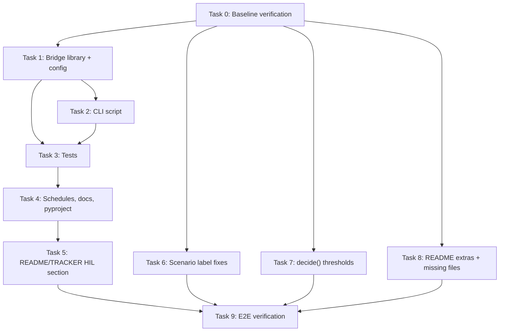

# HIL AbyssLink Bridge — Build Plan

> **Status**: PLANNING — awaiting approval before any source code is created or modified.

---

## 1  Verified Facts

Every interface below was read from the actual source files, not guessed.

### 1.1  Subsea Pipeline Interface

| Item | File | Verified Signature / Detail |
|------|------|-----------------------------|
| `SensorObservation` | `models.py` L24-31 | `(node_id: str, timestamp: float, acceleration: tuple[float,...], position: tuple[float,float], packet_received: bool=True, source: str="simulation", metadata: dict={})` — frozen dataclass |
| `VesselObservation` | `models.py` L34-43 | `(vessel_id: str, timestamp: float, position: tuple[float,float], speed: float, heading: float, reported: bool=True, position_uncertainty: float=0.0, metadata: dict={})` — frozen dataclass |
| `DecisionResult` | `models.py` L83-94 | Contains `.decision`, `.physical_confidence`, `.association_confidence`, `.reliability`, `.uncertainty`, `.hypothesis_scores`, `.rationale`, `.audit` |
| `run_pipeline()` | `pipeline.py` L19-33 | `(observations, vessel, *, sampling_rate=50.0, baseline_rms=1.0, disturbance_rms=1.8, interaction_radius=10.0, temporal_tolerance=5.0, expected_interval=0.02, packet_timeout=1.0, environmental_event=False, now=None, cable_geometry=None) -> DecisionResult` |
| `decide()` | `decision.py` L6-37 | Takes `physical_confidence, association_confidence, reliability, uncertainty, thresholds=None`. Defines `"t2": 0.65` (unused) and hard-codes `uncertainty < 0.35` for T3 at line 37. |
| `estimate_health()` | `health.py` L10-43 | Takes `(observations, *, expected_interval, packet_timeout, now)` -> `SensorHealth` |
| `RawPacketRecorder` | `recording.py` L9-19 | `.append(packet, *, transport: str, received_timestamp: float, sequence: int|None)` — writes JSONL |
| `generate_observations()` | `simulation.py` L140-178 | accel = `(1.0 + A*sin(2pi*8*t) + N(0,noise), N(0,noise), N(0,noise))`, A=0.15 normal / 1.8 disturbed, 50 Hz, 256 samples, environmental=0.55@2Hz, mechanical=0.9@5Hz |
| `__version__` | `__init__.py` | `"0.1.0"` |
| `Mpu6050Packet` | `acquisition.py` L10-32 | Pydantic model; `.to_observation()` sets `source="mpu6050"` |
| `system.yaml` | `config/system.yaml` | Has `result_policy: never_overwrite`, decision thresholds `tx_uncertainty: 0.65`, `tx_reliability: 0.35` |
| Existing tests | `tests/` | 24 test files, badge claims 240 tests passed |

### 1.2  AbyssLink Firmware Interface (read-only)

| Item | File | Detail |
|------|------|--------|
| Serial JSON (sensor) | `AbyssLink_ESP32.ino` L299-339 | `{"type":"sensor","transmission":bool,"ldr":int(0|1),"vibration":int(0|1),"distance_cm":float|null,"distance_valid":bool,"laser":"ON"|"OFF","buzzer":"ON"|"OFF","alert":"..."}` |
| Serial JSON (ack) | `AbyssLink_ESP32.ino` L386-395 | `{"type":"ack","command":"...","success":bool,"transmission":bool}` |
| Baud rate | Line 102 | 115200 |
| Telemetry interval | Line 45 | 300 ms (`TELEMETRY_INTERVAL_MS`) |
| Ultrasonic range guard | Line 179 | 2 cm <= dist <= 450 cm; else `distance_valid=false`, `distance_cm=-1.0` |
| `pulseIn` timeout | Line 42 | 30000 us = 30 ms blocking |
| Commands | Lines 370-383 | `START_TRANSMISSION\n`, `STOP_TRANSMISSION\n` (newline-terminated) |
| Distance thresholds | Lines 37-39 | Critical <=5 cm, Danger <=50 cm, Warning <=80 cm |
| LDR polarity | Line 58 | `0 = light detected`, `1 = interrupted` |
| Vibration polarity | Line 59 | `0 = normal`, `1 = vibration` |
| Alert enum | Lines 64-72 | `SAFE`, `LASER_INTERRUPTION`, `VIBRATION`, `CRITICAL_PROXIMITY`, `PROXIMITY_DANGER`, `PROXIMITY_WARNING`, `DISTANCE_UNAVAILABLE` |
| LDR fault condition | Line 219 | Only when `isTransmissionActive && ldrReading == 1` |

### 1.3  Housekeeping Discrepancies (verified)

| Discrepancy | Source of Truth | TRACKER Says | Code Says |
|-------------|----------------|-------------|-----------|
| S01 | `simulation.py:17` | "Benign transit at cruising speed" | "normal" |
| S02 | simulation.py:18 | "Benign loitering outside cable zone" | "physical disturbance" |
| S03 | simulation.py:19 | "Normal cable crossing without contact" | "vessel only" |
| S04 | simulation.py:20 | "Anchor dragging" | "vessel plus disturbance" |
| S05 | simulation.py:21 | "Bottom-trawling gear interaction" | "environmental event" |
| S06 | simulation.py:22 | "Dropped object / acute impact" | "non-vessel mechanical event" |
| S07 | simulation.py:23 | "Legitimate maintenance vessel operation" | "sensor failure" |
| S08 | simulation.py:24 | "Benign transit in shallow water" | "communication failure" |
| S09 | simulation.py:25 | "Heavy vessel displacement wash" | "noise stress" |
| S10 | simulation.py:26 | "Bad weather and sea-state turbulence" | "packet loss" |
| S11 | simulation.py:27 | "Natural seismic / seismic survey" | "spatial mismatch" |
| S12 | simulation.py:28 | "Marine fauna / biological" | "temporal mismatch" |
| **S13** | simulation.py:29 | **"Single sensor intermittent packet loss"** | **"conflicting evidence"** |
| S14 | simulation.py:30 | "Multiple sensor spatial node failure" | "counter evidence" |
| S15 | simulation.py:31 | "Sensor drift and calibration offset" | "high uncertainty" |
| S16 | simulation.py:32 | "Communication backhaul outage" | "absence of corroboration" |
| **S17** | simulation.py:33 | **"Adversarial AIS transponder intentional shutdown"** | **"AIS spoofing"** |
| **S18** | simulation.py:34 | **"Adversarial AIS spoofing (ghost trajectory injection)"** | **"transponder suppression"** |
| S19 | simulation.py:35 | "Adversarial AIS timestamp manipulation" | "timestamp manipulation" (OK) |
| S20 | simulation.py:36 | "Coordinated spatial offset manipulation" | "spatial manipulation" (OK) |
| S21 | simulation.py:37 | "Multi-vector combined evasion" | "combined adversarial evasion" (OK) |
| S22 | simulation.py:38 | "Multi-vessel ambiguous association" | "multiple vessels and disturbances" (OK) |

**`decide()` issues:** `"t2": 0.65` is defined in the limits dict at line 17 but never referenced in the decision logic. T3 promotion uses hard-coded `uncertainty < 0.35` at line 37 instead of `limits["t3_uncertainty"]`.

**Missing files listed in README:** `calibration.py` and `evaluation.py` are referenced in the repo structure block (lines 58, 63) but do not exist as standalone files. Calibration functions live in `metrics.py`; evaluation functions live in `experiments.py` / `oliktok_evaluation.py` / `real_evaluation.py`.

**`requirements.txt` vs README:**
- `requirements.txt` = `-e .[test,ui,realdata]` — includes `realdata`, omits `ml`
- README install section = `pip install -e .[test,ui,ml]` — includes `ml`, omits `realdata` and `hil`
- `pyproject.toml` extras defined: `ui`, `test`, `ml`, `realdata` — no `hil` extra exists yet

**No `web/` directory** exists under `SUBSEA/`. Must be created for `web/hil/latest.json`.

---

## 2  Assumptions (cannot verify without hardware or runtime)

| # | Assumption | Impact if wrong |
|---|-----------|-----------------|
| A1 | `pyserial` can open COM ports / `/dev/ttyUSB*` on the target platform | Bridge `--port` mode won't work; mock/replay unaffected |
| A2 | The ESP32 reliably sends `\n`-terminated JSON at 115200 baud without inter-character gaps that would split a JSON object across two reads | If this happens, the line-buffered reader handles it correctly |
| A3 | `distance_cm` arrives as a JSON number (float) when valid, and `null` when invalid — not a string `"null"` | Parser must handle edge cases |
| A4 | Malformed lines are primarily truncated JSON or ESP32 boot messages (e.g. `"rst:0x1..."`) | Counter increments; no crash |
| A5 | 300 ms telemetry ~ 3.33 Hz is stable enough that we can synthesize ~16-17 accel samples per packet interval to hit 50 Hz | Drift is bounded and acceptable |
| A6 | The existing 240 tests pass in the current environment; no hidden breakage | Will verify by running `pytest` before any changes |

---

## 3  Build Tasks

### Task 0 — Baseline verification (pre-flight)

**Goal:** Confirm the existing test suite passes and `./abysslink` is clean.

**Files touched:** None.

**Steps:**
1. `cd SUBSEA && python -m pytest tests/ -q`
2. `cd ../AbyssLink && git status && git diff --stat`

**Acceptance:**
```
python -m pytest tests/ -q          # 240 passed
cd ../AbyssLink && git status       # nothing to commit, working tree clean
```

**Must not change:** Anything.

---

### Task 1 — Bridge library (`hil_abysslink.py`) + Config

**Goal:** Create the core bridge library module and its YAML config.

**Files created:**
- `src/subsea/hil_abysslink.py` — all bridge classes and functions
- `config/hil_abysslink.yaml` — scale factors, debounce, grace period, window sizes

**Key classes/functions to implement:**
1. `HILConfig` — loads YAML config, all tunables with defaults
2. `AbyssLinkPacket` — dataclass for parsed telemetry packet
3. `parse_abysslink_line(line: str) -> AbyssLinkPacket | None` — JSON parser with malformed-line counting
4. `MockAbyssLinkSource(seed, scenario)` — deterministic emulator (approach, retreat, link break, no-echo)
5. `ReplayAbyssLinkSource(path, seed)` — JSONL replay with virtual clock
6. `SerialAbyssLinkSource(port, baudrate)` — pyserial wrapper (lazy import)
7. `AccelSynthesizer(seed, config)` — 50 Hz MPU6050 stream from vibration flag + schedule injections
8. `DistanceToVessel(config)` — distance_cm -> VesselObservation mapper (scale, smoothing, speed estimation)
9. `LinkHealthTracker(config)` — LDR debounce, grace period, gap detection -> packet_received
10. `ScheduleInjector(schedule_path)` — reads JSON schedule, applies injections at timestamps
11. `HILBridge` — main orchestrator: source -> parse -> synthesize accel -> map vessel -> run_pipeline -> record
12. `HILManifest` — writes manifest.json with seed, config hash, SHA-256 of logs, counters
13. `write_pointer(run_dir)` — writes/overwrites `web/hil/latest.json`

**No side effects on import:** All `pyserial` imports are inside `SerialAbyssLinkSource.__init__()` behind a try/except with a helpful error message.

**Config file (`config/hil_abysslink.yaml`):**
```yaml
distance:
  scale_factor: 0.1        # 80 cm -> 8 m
  smoothing_window: 5       # packets for speed estimation
  min_valid_cm: 2.0         # below this -> unavailable
signal:
  ldr_debounce_packets: 2
  vibration_debounce_packets: 2
  grace_period_s: 0.5       # ignore LDR after START_TRANSMISSION
  packet_timeout_s: 1.0
pipeline:
  sampling_rate: 50.0
  window_size: 256
  baseline_rms: 1.0
  disturbance_rms: 1.8
  interaction_radius: 10.0
  temporal_tolerance: 5.0
  expected_interval: 0.02
accel:
  baseline_amplitude: 0.15
  disturbance_amplitude: 1.8
  frequency_hz: 8.0
  noise_std: 0.03
mock:
  approach_start_cm: 120.0
  approach_end_cm: 20.0
  retreat_end_cm: 150.0
  link_break_duration_s: 3.0
  no_echo_duration_s: 2.0
```

**Acceptance:**
```
python -c "from subsea.hil_abysslink import HILBridge, HILConfig; print('OK')"
# Must not import pyserial or create any files
python -m pytest tests/ -q    # existing 240 tests still pass
```

**Must not change:** Any existing file in `src/subsea/`. No changes to `./abysslink/`.

---

### Task 2 — CLI script (`run_abysslink_hil.py`)

**Goal:** Create the CLI entry point.

**Files created:**
- `scripts/run_abysslink_hil.py`

**CLI interface:**
```
python scripts/run_abysslink_hil.py --mock [--seed 42] [--config config/hil_abysslink.yaml]
                                                        [--schedule data/hil_schedules/approach_vibration.json]
                                                        [--send-commands]
                                                        [--replay-baselines]
python scripts/run_abysslink_hil.py --port COM3 [...]
python scripts/run_abysslink_hil.py --replay data/recorded.jsonl [...]
```

**Runtime outputs (append-only, never overwrite):**
- `artifacts/hil/run-<UTC>/decisions.jsonl`
- `artifacts/hil/run-<UTC>/raw.jsonl`
- `artifacts/hil/run-<UTC>/manifest.json`
- `web/hil/latest.json` (pointer, rewritten)

**End-of-run summary:** Decision counts per label, agreement with "expected", time-to-escalation.

**Acceptance:**
```
python scripts/run_abysslink_hil.py --mock --seed 42
# Runs to completion, prints summary table
# Creates artifacts/hil/run-*/decisions.jsonl, raw.jsonl, manifest.json
# Creates web/hil/latest.json
python -m pytest tests/ -q    # existing tests still pass
```

**Must not change:** Any existing file. No changes to `./abysslink/`.

---

### Task 3 — Deterministic tests (`test_hil_abysslink.py`)

**Goal:** Full test coverage for the bridge, all deterministic.

**Files created:**
- `tests/test_hil_abysslink.py`

**Test cases (all use mock source or synthetic packets, no serial port):**

| # | Test | Assert |
|---|------|--------|
| T1 | `test_mock_far_quiet` | T0 dominant in decisions |
| T2 | `test_mock_approach_vibration` | Reaches T2 or T3 with ca > 0.6 |
| T3 | `test_vibration_no_vessel` | T1, never T2/T3 |
| T4 | `test_link_broken_transmitting` | TX when ldr==1 && transmission==true >= debounce |
| T5 | `test_ldr_high_transmission_off` | No fault (not TX) |
| T6 | `test_telemetry_gap` | Reliability drops |
| T7 | `test_ais_spoof_injection` | T1 or TX, never T2/T3 |
| T8 | `test_ais_timestamp_injection` | T1 or TX, never T2/T3 |
| T9 | `test_ais_suppress_injection` | T1 or TX, never T2/T3 |
| T10 | `test_distance_invalid_not_zero` | distance_valid=false never maps to 0 cm |
| T11 | `test_malformed_lines` | Counted and skipped, no crash |
| T12 | `test_deterministic_same_seed` | Same seed -> byte-identical decisions.jsonl |
| T13 | `test_pointer_file_valid` | web/hil/latest.json points at existing decisions file |
| T14 | `test_parse_abysslink_sensor` | Correct parsing of all fields |
| T15 | `test_parse_abysslink_ack` | Ack packets are identified and skipped |
| T16 | `test_grace_period` | LDR==1 packets during grace period are not faults |
| T17 | `test_accel_synthesizer_50hz` | Generates correct number of samples at 50 Hz |
| T18 | `test_distance_to_vessel_mapping` | 80 cm -> position (8.0, 0), speed and heading correct |

**Acceptance:**
```
python -m pytest tests/test_hil_abysslink.py -v    # all pass
python -m pytest tests/ -q                          # 240 + N new tests pass
```

**Must not change:** Any existing test file. No changes to `./abysslink/`.

---

### Task 4 — Schedules, docs, and pyproject extras

**Goal:** Create injection schedules, HIL documentation, and add `hil` optional dependency.

**Files created:**
- `data/hil_schedules/approach_vibration.json` — vessel approach + vibration event
- `data/hil_schedules/link_fault.json` — laser interruption during transmission
- `data/hil_schedules/adversarial_spoof.json` — AIS spoofing injection
- `data/hil_schedules/environmental.json` — environmental disturbance (0.55 @ 2 Hz)
- `data/hil_schedules/quiet_baseline.json` — no injections (pure baseline)
- `docs/HIL_ABYSSLINK.md` — mapping table, how to run, validity limits, scientific integrity

**Files modified:**
- `pyproject.toml` — add `hil = ["pyserial>=3.5"]` to `[project.optional-dependencies]`

**Acceptance:**
```
python -c "import json; json.load(open('data/hil_schedules/approach_vibration.json'))"
cat docs/HIL_ABYSSLINK.md | head -5   # file exists with proper content
grep 'hil' pyproject.toml             # hil extra present
python -m pytest tests/ -q            # all tests still pass
```

**Must not change:** Any existing schedule, doc, or artifact. No changes to `./abysslink/`.

---

### Task 5 — README/TRACKER HIL section

**Goal:** Add HIL section to README.md and TRACKER.md without altering existing results.

**Files modified:**
- `README.md` — append HIL section after "Hardware Status" (line 207), update install extras mention
- `TRACKER.md` — append HIL phase after line 170

**Content for README:**
- HIL badge, description, CLI commands
- State: this validates integration, NOT subsea sensing physics
- Link to `docs/HIL_ABYSSLINK.md`

**Content for TRACKER:**
- New phase: "Phase 15 — Hardware-in-the-Loop AbyssLink Bridge"
- Checked items for bridge library, CLI, config, schedules, tests, docs

**Acceptance:**
```
grep "HIL" README.md        # present
grep "HIL" TRACKER.md       # present
python -m pytest tests/ -q  # all tests still pass
```

**Must not change:** Existing results, metrics, or scenario descriptions in the body. No changes to `./abysslink/`.

---

### Task 6 — Housekeeping: scenario label fixes (separate commit)

**Goal:** Fix TRACKER scenario labels to match `simulation.py` (code is source of truth). Prove outputs are unchanged.

**Files modified:**
- `TRACKER.md` — lines 33-54, update all 22 scenario descriptions to match `_DEFINITIONS` in `simulation.py`

**Exact changes (TRACKER lines 33-54):**

| Line | Old (TRACKER) | New (from code) |
|------|---------------|-----------------|
| 33 | "Benign transit at cruising speed" | "Normal baseline (no vessel, no disturbance)" |
| 34 | "Benign loitering outside cable zone" | "Physical disturbance (no vessel)" |
| 35 | "Normal cable crossing without contact" | "Vessel only (no disturbance)" |
| 36 | "Anchor dragging (...)" | "Vessel plus disturbance" |
| 37 | "Bottom-trawling gear interaction" | "Environmental event" |
| 38 | "Dropped object / acute impact" | "Non-vessel mechanical event" |
| 39 | "Legitimate maintenance vessel operation" | "Sensor failure" |
| 40 | "Benign transit in shallow water" | "Communication failure" |
| 41 | "Heavy vessel displacement wash..." | "Noise stress" |
| 42 | "Bad weather and sea-state turbulence" | "Packet loss" |
| 43 | "Natural seismic / seismic survey..." | "Spatial mismatch" |
| 44 | "Marine fauna / biological..." | "Temporal mismatch" |
| 45 | **"Single sensor intermittent packet loss"** | **"Conflicting evidence"** |
| 46 | "Multiple sensor spatial node failure" | "Counter evidence" |
| 47 | "Sensor drift and calibration offset" | "High uncertainty" |
| 48 | "Communication backhaul outage" | "Absence of corroboration" |
| 49 | **"Adversarial AIS transponder intentional shutdown"** | **"AIS spoofing"** |
| 50 | **"Adversarial AIS spoofing (ghost trajectory injection)"** | **"Transponder suppression"** |

**Acceptance:**
```
python -m pytest tests/ -q    # all tests still pass (labels are docs-only)
```

**Must not change:** Any `.py` file, any artifact, any result number. No changes to `./abysslink/`.

---

### Task 7 — Housekeeping: `decide()` thresholds (separate commit)

**Goal:** Wire the unused `"t2": 0.65` limit and the hard-coded T3 `uncertainty < 0.35` to use the `limits` dict, then prove outputs are unchanged.

**Files modified:**
- `src/subsea/decision.py` — line 37: replace `uncertainty < 0.35` with `uncertainty < limits["t3_uncertainty"]`; add `"t3_uncertainty": 0.35` to default limits dict; optionally wire `"t2"` or remove it
- `config/system.yaml` — add `t3_uncertainty: 0.35` under `decision:`

**Verification strategy:**
1. Run all 22 scenarios with seed 42 before and after
2. Compare decision outputs — must be identical
3. Run `python -m pytest tests/ -q` — all pass
4. The `decision_regression_report.json` already exists at `artifacts/audit/decision_regression_report.json`

**Acceptance:**
```
python -m pytest tests/ -q     # all tests pass
# Decision regression: run all 22 scenarios, compare with existing report
python -c "
from subsea.simulation import make_scenario, generate_observations
from subsea.pipeline import run_pipeline
for i in range(1,23):
    s = make_scenario(f'S{i:02d}', 42)
    obs, v = generate_observations(s)
    r = run_pipeline(obs, v, environmental_event=s.environmental_event)
    print(f'S{i:02d}: {r.decision}')
"
# Output must match existing regression report exactly
```

**Must not change:** Decision outputs for any scenario/seed. No changes to `./abysslink/`.

---

### Task 8 — Housekeeping: README install extras + missing files (separate commit)

**Goal:** Make install instructions consistent and document missing files.

**Files modified:**
- `requirements.txt` — change to `-e .[test,ui,ml,realdata,hil]`
- `README.md` — update install command to `pip install -e .[test,ui,ml,realdata,hil]`
- `README.md` — add note that `calibration.py` and `evaluation.py` listed in the repo structure block are not standalone files; calibration is in `metrics.py`/`experiments.py`, evaluation is in `experiments.py`/`*_evaluation.py`

**Acceptance:**
```
grep "hil" requirements.txt        # present
grep "realdata" requirements.txt   # present
grep "ml" requirements.txt         # present
python -m pytest tests/ -q         # all tests pass
```

**Must not change:** Any result or artifact. No changes to `./abysslink/`.

---

### Task 9 — End-to-end verification

**Goal:** Run `--mock` end to end, show summary table, verify `./abysslink` is clean.

**Files touched:** None (runtime only).

**Steps:**
1. `python scripts/run_abysslink_hil.py --mock --seed 42`
2. Display the summary table (decision counts, agreement with expected, time-to-escalation)
3. Verify output files exist: `artifacts/hil/run-*/decisions.jsonl`, `raw.jsonl`, `manifest.json`, `web/hil/latest.json`
4. `cd ../AbyssLink && git status && git diff --stat` — must be clean

**Acceptance:**
```
python scripts/run_abysslink_hil.py --mock --seed 42    # completes, prints summary
ls artifacts/hil/run-*/decisions.jsonl                    # file exists
cat web/hil/latest.json                                   # valid JSON pointing to run dir
cd ../AbyssLink && git status                             # nothing to commit
cd ../AbyssLink && git diff --stat                        # (empty)
```

**Must not change:** Any existing artifact or source file. `./abysslink/` must remain completely clean.

---

## 4  Task Dependency Graph



Tasks 6, 7, 8 are independent housekeeping and can be done in parallel with Tasks 1-5.

---

## 5  Risks and Open Questions

| # | Risk / Question | Mitigation |
|---|----------------|------------|
| R1 | The accelerometer synthesis at 50 Hz from 3.3 Hz binary vibration flag may produce unrealistic spectral characteristics compared to a real MPU6050 | Document as a known limitation. The 8 Hz sine model matches `simulation.py` exactly, which is what the pipeline was validated against. |
| R2 | Distance scaling (80 cm -> 8 m) is arbitrary; real cable-to-vessel distances are much larger | Config-driven; document that this is a benchtop proxy. HIL validates the _integration path_, not the physical scale. |
| R3 | `run_pipeline()` expects `expected_interval=0.02` (50 Hz) but real packets arrive at ~0.3 s. Health module will flag irregular intervals. | The bridge synthesizes 50 Hz observations _between_ real packets. The 0.02 interval applies to the synthetic samples, not the raw telemetry. |
| R4 | The `SensorObservation.source` field defaults to `"simulation"`. Need to tag HIL data distinctly. | Use `source="hil_simulated_accel"` for synthesized observations and `metadata={"data_kind": "HIL_SIMULATED_ACCEL", ...}` |
| R5 | `web/hil/latest.json` is the only file rewritten (violates `never_overwrite` for other files). Need to ensure the pointer mechanism doesn't conflict with any existing `result_policy` logic. | The pointer file is a separate mechanism, not a result/artifact file. Document this. |
| R6 | If `decide()` thresholds are changed in Task 7, it's critical that all 22 scenarios produce identical decisions. | Run full regression before and after; diff the outputs. |
| R7 | The README repo-structure block lists `calibration.py` and `evaluation.py` which don't exist. Should we create stub files or just fix the docs? | The task spec says "report this, do not invent the files." We document the discrepancy and fix the README. |
| R8 | `pyserial` is not currently a dependency. Adding `hil` extra requires testing that `pip install -e .[hil]` works. | Tested as part of Task 4 acceptance. |
| R9 | Will the existing test suite tolerate a new `hil_abysslink.py` module existing? (e.g., `test_scientific_integrity.py` might scan modules) | Read `test_scientific_integrity.py` before implementation to check for module-scanning assertions. |

### Open Questions for User

1. **Commit strategy**: Should Tasks 6/7/8 (housekeeping) be committed _before_ or _after_ the HIL bridge tasks? The spec says "separate commits" — I plan to make them independent PRs/commits.

2. **Mock scenario duration**: How long should the default `--mock` run be? I plan ~30 seconds (100 telemetry packets at 3.3 Hz), producing ~1500 accel samples, enough for ~6 decision windows.

3. **`--replay-baselines` scope**: Should this run all `ABLATION_VARIANTS` from `experiments.py`, or just `("proposed", "physical_only", "vessel_only")`?

---

## 6  File Impact Summary

### New files (all under `./SUBSEA/`)
| File | Task |
|------|------|
| `src/subsea/hil_abysslink.py` | T1 |
| `config/hil_abysslink.yaml` | T1 |
| `scripts/run_abysslink_hil.py` | T2 |
| `tests/test_hil_abysslink.py` | T3 |
| `data/hil_schedules/approach_vibration.json` | T4 |
| `data/hil_schedules/link_fault.json` | T4 |
| `data/hil_schedules/adversarial_spoof.json` | T4 |
| `data/hil_schedules/environmental.json` | T4 |
| `data/hil_schedules/quiet_baseline.json` | T4 |
| `docs/HIL_ABYSSLINK.md` | T4 |
| `web/hil/latest.json` | T9 (runtime) |
| `artifacts/hil/run-*/` | T9 (runtime) |

### Modified files (all under `./SUBSEA/`)
| File | Task | Nature of change |
|------|------|-----------------|
| `pyproject.toml` | T4 | Add `hil` optional extra |
| `README.md` | T5, T8 | Add HIL section; fix install extras; note missing files |
| `TRACKER.md` | T5, T6 | Add HIL phase; fix scenario labels |
| `src/subsea/decision.py` | T7 | Wire `t3_uncertainty` to limits dict |
| `config/system.yaml` | T7 | Add `t3_uncertainty: 0.35` |
| `requirements.txt` | T8 | Add `ml`, `hil` extras |

### Files in `./abysslink/` — NONE. Zero changes.
